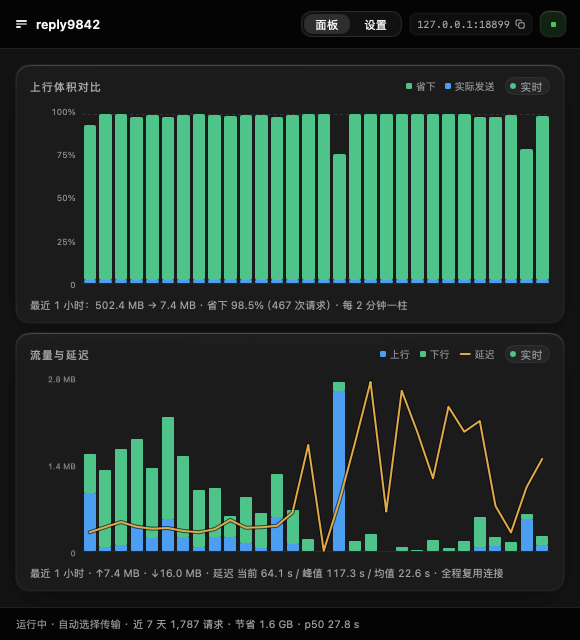
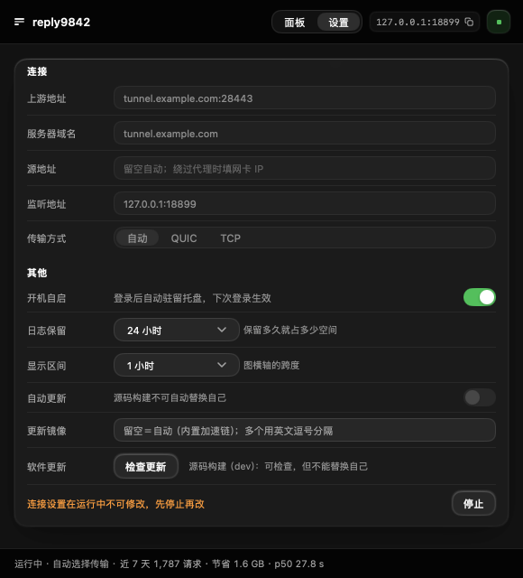

# reply9842

**基于内容寻址基版本的增量压缩隧道，把 AI Agent 的上行带宽砍掉 99.8%。**

Agent 每请求要重传 1.3–2.2 MB 的完整上下文，日请求 2 万+，日上行 20–44 GB。
本项目把同一份请求压到**几百字节**——因为相邻请求里 90% 以上的字节，上一轮已经传过了。

```
279.8 MB  ──▶  659 KB     （215 条真实请求，压缩比 0.225%）
单条中位数：1.4 MB  ──▶  1,052 B
```

> 数据来自生产环境连续观测，含推理型模型的完整上下文。见[实测](#实测)。
>
> 它对协议本身不做任何假设：只是一个 HTTP 正向转发，任何「请求体大且相邻请求高度相似」
> 的流量都适用。不绑定任何服务商，也不需要客户端侧改协议。

---

## 它解决什么问题

自建 Agent 跑 LLM 请求时，每一次调用都要把完整上下文重新上传：system prompt + tools schema + 全部多轮历史。
上下文越长，重复传的字节越多。实测某生产 Agent 的负载：

| 指标 | 实测值 |
|---|---|
| 日请求量 | 22,000+ |
| 单请求上行 | 1.3–2.2 MB |
| 日上行 | 20–44 GB |
| 日下行 | 3 GB（上行/下行 ≈ 14.8:1）|
| 相邻请求体积比 p50 | **1.003**（几乎完全相同）|

**关键洞察**：相邻请求的体积极少变化，说明绝大部分内容是重复传输。

而 gzip 只能压到 **32%**（实测 gzip -9：1.32 MB → 471 KB）——因为 gzip 是**无状态**的，
每个请求都从零开始找重复，永远看不到「上一轮刚传过的 1.3 MB」。

## 方案：内容寻址的整文档 delta

```
relay-client (本地)                    relay-server (远端)
──────────────────                     ──────────────────
Agent → :18899
  │
  ├─ 1. 选基线：在历史请求里找「块哈希命中率」最高的
  ├─ 2. zstd delta：把基线当字典压缩新请求
  ├─ 3. 40 字节 dcz 头（magic + BLAKE3 哈希）+ zstd 流
  └─ QUIC/TCP 隧道发出
                                        │
                                        ├─ 按哈希从 store 取字典
                                        ├─ 解 delta + 校验 ResultHash
                                        ├─ 转发到上游（同机回环）
                                        └─ 存本次 body 供后续当基线
```

Agent 完全无感：只是把 `base_url` 指向 `http://127.0.0.1:18899`。
隧道两端都是有状态的压缩器——**上一轮的请求体就是这一轮的字典**。

## 实测效果

### 14 条连续真实请求（生产日志）

| 时间 | 请求体 | 线宽 | 压缩比 | 编码 |
|---|---:|---:|---:|---|
| 10:51:02 | 111 | 111 | 100.000% | identity |
| 10:53:29 | 1,316,641 | 250 | 0.019% | resend-full † |
| 10:53:35 | 2,022,098 | 343 | 0.017% | resend-full † |
| 10:54:10 | 1,319,782 | 960 | 0.073% | dcz(L19) |
| 10:54:11 | 2,027,965 | 1,777 | 0.088% | dcz(L19) |
| 10:54:32 | 2,035,095 | 2,521 | 0.124% | dcz(L19) |
| 10:54:36 | 1,330,887 | 3,024 | 0.227% | dcz(L19) |
| 10:54:44 | 2,036,158 | 655 | 0.032% | dcz(L19) |
| 10:55:03 | 1,337,093 | 1,724 | 0.129% | dcz(L19) |
| 10:55:13 | 2,041,295 | 1,874 | 0.092% | dcz(L19) |
| 10:55:13 | 1,345,230 | 2,190 | 0.163% | dcz(L19) |
| 10:55:28 | 2,053,162 | 3,414 | 0.166% | dcz(L19) |
| 10:55:30 | 1,346,946 | 461 | 0.034% | dcz(L19) |
| 10:55:46 | 2,060,805 | 1,607 | 0.078% | dcz(L19) |
| **合计** | **22,273,268** | **20,911** | **0.094%** | 省 **99.9%** |

† 这 2 条首次 delta 未命中（服务端此时还没有可用的基线），触发了全量重发。
上表 `线宽` 列只计首次尝试，**不含**该次重发的约 762 KB。这是冷启动的真实代价。

### 生产环境全量观测（同一日志，215 条 dcz 命中）

**293,343,255 字节 → 659,452 字节 = 0.225%**（省 99.78%）。

单条线宽分布：p50 **1,052 字节**、p90 4,860 字节、最大 91,469 字节。

其中 11:04–11:06 连续 14 条（基线完全就位、无冷启动）：
**24,798,163 字节 → 10,241 字节 = 0.041%**。

> 同一份日志里更早的 199 条（旧基线算法，公共前缀判定）压缩比是 1.738%。
> 换成块哈希判定后降到 0.225%，改善 7.7 倍。两组都保留在日志里，可复算。

### 与无状态压缩对比（同一批真实请求体，本机实测）

| 方案 | 14 条累计线宽 | 占原体积 | 相对本项目 |
|---|---:|---:|---:|
| 原始请求体 | 22,273,268 | 100% | — |
| gzip -9 | 7,049,305 | 31.65% | 慢 337× |
| zstd -19（无字典） | 5,045,979 | 22.65% | 慢 241× |
| **dcz delta** | **20,911** | **0.094%** | — |

单条 1.35 MB 请求上差距更明显：gzip -9 = 471,780 B，dcz = 461 B，**相差 1023 倍**。

### 全量样本（含冷启动）

生产日志里 332 条成功走 delta 的请求，合计 **346,857,922 B → 3,042,281 B = 0.88%**（省 99.1%）。
逐条中位数 0.25%，p90 为 3.7%——冷启动与基线淘汰会拉低平均值，这是有状态压缩的固有特性。

## 快速开始

### 1. 服务端（部署在能直连上游的那台机器）

```bash
go build -o relay-server ./cmd/server

./relay-server \
  -listen 0.0.0.0:28443 \
  -upstream http://127.0.0.1:3431 \
  -uphost magpie.aiweb.xin \
  -cert /path/to/fullchain.pem \
  -key  /path/to/privkey.pem
```

**`-upstream` 必须是 `127.0.0.1`（或同机内网地址）。** 若填公网域名，流量会绕一整圈公网
（实测：某云主机公网 IP 不在网卡上，`172.17.61.35` 才是真实内网地址）。
QUIC 与 TCP/TLS 共用同一个端口。

### 2. 客户端（和 Agent 同机）

```bash
go build -o relay-cli ./cmd/cli

./relay-cli \
  -listen 127.0.0.1:18899 \
  -server 47.82.76.102:28443 \
  -server-name magpie.aiweb.xin \
  -transport auto
```

然后把 Agent 的 `base_url` 指向 `http://127.0.0.1:18899`。其余不变。

> **用 IP 直连时必须给 `-server-name`。** 服务端证书的 SAN 只有 DNS 没有 IP，
> 留空会按 `-server` 的 host（那个 IP）推导 SNI，必然 `x509: cannot validate
> certificate ... doesn't contain any IP SANs`。用域名连则不需要显式指定。

#### 连不上？先怀疑本机代理

如果本机开着代理的 **TUN / 增强模式**（Clash 系常见），它用
`0.0.0.0/1` + `128.0.0.0/1` 两条路由把整个 IPv4 空间导进 utun，隧道流量也被吞进去；
代理对 `28443` 这类非标端口没有正确规则，TLS 握手会被中途切断，表现为
`tcp tls: EOF` 或 `quic ... no application protocol`——看起来像服务端崩了。

两条解法，任选其一：

1. 在代理里把服务器 IP 加进**直连规则**（推荐）
2. 加 `-local-addr <本机网卡 IP>` 绑定出站源地址，让内核直接走物理网卡：

```bash
ipconfig getifaddr en0          # macOS 取网卡 IP
./relay-cli -local-addr 192.168.1.106 ...
```

### 客户端参数

| 参数 | 默认 | 说明 |
|---|---|---|
| `-listen` | `127.0.0.1:18899` | 本地 HTTP 入口 |
| `-server` | `47.82.76.102:28443` | relay-server 的 host:port |
| `-server-name` | `magpie.aiweb.xin` | TLS SNI（用 IP 连时必须填证书域名）|
| `-local-addr` | 空 | 绑定出站源地址，绕过代理 TUN 劫持 |
| `-transport` | `auto` | `auto` / `quic` / `tcp` |
| `-insecure` | `false` | 跳过证书校验（自签观察期）|
| `-min-delta` | `16384` | 小于此值的请求体不做 delta |
| `-history-mb` | `64` | 基线历史总字节预算（MB，约 35 条 1.8MB 请求）|
| `-max-resume` | `3` | 断线后最大续传重试次数（`0` = 不续传）|
| `-capture-dir` | 空 | 采样目录：把请求体原样落盘供离线分析 |
| `-capture-n` | `30` | 最多采样多少条 |
| `-log` / `-stats` | `~/.reply9842/` | 日志与统计路径 |

### 服务端参数

| 参数 | 默认 | 说明 |
|---|---|---|
| `-listen` | `0.0.0.0:28443` | 隧道监听（QUIC + TCP 同端口）|
| `-upstream` | `http://127.0.0.1:3431` | 上游 base URL |
| `-uphost` | `magpie.aiweb.xin` | 转发时覆盖的 Host 头 |
| `-cert` / `-key` | 必填 | TLS 证书 |
| `-cache-mb` | `256` | 基版本缓存上限（内存，内容寻址 LRU）|
| `-spool-dir` | `/var/lib/reply9842/spool` | 流式响应 spool 根目录 |
| `-tmp-mb` | `512` | 活跃区字节预算 |
| `-idem-mb` | `2048` | 幂等区字节预算 |
| `-upstream-timeout` | `10m` | 上游请求超时（不随客户端断开取消）|
| `-health-addr` | 空 | 健康检查监听（如 `127.0.0.1:8080`）；留空不启用 |
| `-health-probe` | `false` | 探针模式：GET 自己的 `/healthz`，成功 exit 0。给 scratch 镜像的 HEALTHCHECK 用（容器内无 curl）|

## 图形界面

CLI 与 GUI 是同一套逻辑的两条外壳：托盘常驻、关窗不退出、单实例。
面板把压缩率与上下行流量画成两张图，底栏一行给出实时速率、握手延迟与累计节省；
设置页管连接参数、开机自启与自动更新。

<p>
  
  
</p>

截图不是画上去的：`cmd/gui/site_shots_test.go` 读真实的 `client-<date>.jsonl`，
用 `stats.Open` 把最近两小时的日志流式重放成时间桶，再离屏渲染成 PNG。

```bash
SITE_SHOTS_DIR=/tmp/site go test ./cmd/gui -run TestSiteShots -v
```

### 自动更新（默认关闭）

设置页里是一个开关，默认**关**。打开后按与 npm 引导器完全一致的镜像链下载
（`REPLY9842_MIRROR` 同一个环境变量、同样的 CSV 规则、同样的直连兜底），
并强制校验 `SHA256SUMS.txt`。替换前会先试跑新二进制：能启动、退出码 0、
输出里含产品标识 `reply9842`——三条都过才在同一目录内原子替换，旧版本留成
`.old-<version>` 供回滚，随后重启并恢复更新前的运行/停止状态。

源码构建（版本为 `dev` / `git describe` 形态 / 带 `-dirty`）**一律不参与**自动替换，
连下载都不会发生——避免开发机上把自己编译的二进制换成发布版。

## 三个关键设计决策

### 1. 不做块级去重，做整文档 delta

调研实测（FastCDC，min 2KB / avg 8KB / max 64KB，292 KB agent 请求）：

| 方案 | 成本 |
|---|---:|
| FastCDC 块级去重 | **17 KB**（23 块，19 块可复用）|
| **整文档 zstd delta** | **1,297 B** |

**差 13 倍。** 原因：LLM 会话是**尾部追加**为主，LZ77 的变长 match 天然对「未变的前缀」
只编码 2–3 字节；块级去重则把未变的 12.7 KB 当成不可分割的原子。

唯一例外是跨会话的固定前缀（system + tools schema），这个用共享字典
（`-D` / `WithEncoderDictRaw`）即可，仍然不需要 CDC。

### 2. 基线判定用「块哈希命中率」而不是「公共前缀」

40 条真实请求体、1,560 组配对实测（`go test ./internal/basefind -run TestBlockReuseOnRealSamples -v` 可复现）：

| 指标 | 同簇复用率 | 跨簇复用率 | 区分度 |
|---|---:|---:|---:|
| 从头的最长公共前缀 | **0%** | 0% | **0%（完全失效）** |
| 4 KB 块哈希命中率 | **91.5%** | **1.6%** | **+90 个百分点** |

根因：真实请求从**第 45 字节**起就不同——

```
{"model":"deepseek-v4.1-flash","max_tokens":343755,…
{"model":"deepseek-v4.1-flash","max_tokens":160014,…
                                          ↑ 第 45 字节
```

平均公共前缀只有 **45 字节**，但第 64 字节之后有 **93%** 的字节逐字节相同。
「从头算前缀」永远只看得到前 45 字节，于是判定「不值得做 delta」，白扔 1.3 MB。

块哈希命中率能跨过变化点：基线切 4 KB 块建索引，新请求滑动匹配，统计可复用字节占比。
实测区分度 ~90 个百分点，阈值取 0.5（值得组 84–93%，不值得组 1.4–2.2%，中间是空档）。

### 3. 一致性靠内容哈希，不需要「字典目录」

```
client: BaseHash = blake3(上一轮 body)   ← 32 字节
server: store[BaseHash] 存在 → 解码；不存在 → DeltaMiss → 客户端重发全量
```

- **没有目录**：`store` 是纯 `hash → body` 的 KV
- **没有版本号**：不存在「第几版」这种需要双向同步的可变状态
- **没有会话 ID**：服务端完全无状态，可水平扩展
- **协商成本固定 32 字节**，不随缓存规模增长

这与 RFC 9842 §2.1.3 一致：**服务端 ID 不得用于保证字典内容，必须校验哈希**。

#### 历史教训：SDCH 为什么死了

Chrome 59 移除 SDCH，原因是字典老化太快，压缩率退化到不如 gzip，维持字典新鲜度的成本超过收益。
RFC 9842 之所以存活，是把「字典老化」转成了 HTTP 缓存问题。

**启示**：不要设计「客户端块缓存 + 服务端块缓存 + 一致性协议」——那是 SDCH 的坑。
「上一轮 body 当字典」天然随会话推进而更新，不存在老化。

## 防静默损坏（三道防线，不可关闭）

这是本方案最危险的地方。zstd 的 frame checksum 可以关闭（`--no-check`），一旦关闭 +
字典错误 + 内容仍可解码，就会得到**语义正确但内容错乱**的 LLM 请求——模型不报错，
只给出奇怪回答，几天后才发现。

1. `zstd.WithEncoderCRC(true)` —— 帧级 checksum
2. dcz 头里的 BLAKE3 哈希 —— 解压前与提供的字典校验
3. `ResultHash` —— 客户端声明「解码后应得到的 body 哈希」，服务端解压后验证

任一失败都返回错误帧，客户端重发全量。三道全部强制开启，没有关闭开关。

## 断线续传

网络抖动时，Agent 侧的请求重试不该导致「上游白跑一遍」。

- 上游请求用 `context.WithoutCancel` 派生 —— **客户端断开不影响上游继续接收**
- 响应流边收边落盘（磁盘双区域 spool：`tmp/` 活跃 + `idem/` 幂等，按字节预算淘汰）
- 客户端重连带 `IdemKey` + `ResumeFrom`（字节偏移）或 SSE `event id`
- `FrameDone` 终止帧区分「上游正常完成」与「连接断了需要续传」

实测：60 个 SSE 事件的响应在断开后重连，拼接**连贯无重复**。

## 传输层：QUIC / TCP 双栈

```
-transport=auto|quic|tcp     默认 auto
```

**关于「QUIC 能否优雅回退」的澄清**：HTTP/3 的自动回退是 **HTTP 协议族**的能力
（浏览器用 `Alt-Svc` 探测，失败退回 HTTP/2 over TCP），**不是 QUIC 传输层自带**。
`quic-go` 连不上就是连不上。

因此回退逻辑实现在应用层（`transport.DialAuto`）：先试 QUIC（默认 1 s 超时），
失败降级 TCP+TLS，并记住结果用于后续连接的优先级。

### 连接复用：把每个请求的握手成本摊掉

本机→香港实测单次 TCP+TLS 握手 **747 / 2330 / 2821 / 773 / 3188 ms**（均值约 2 s），
而最早的实现每个请求都新建连接、用完即关——等于每个请求白扔一到三秒，
比隧道省下的带宽更值钱。

现在走**串行复用池**（`internal/transport/pool.go`）：LIFO 取用、空闲 90 秒淘汰、
最多 4 条常驻，同一个请求的出入口仍是「一条连接上一问一答」。选串行而不做多路复用，
是因为多路复用要引入请求 ID、乱序重组与流量控制，改动面覆盖帧格式、双端流控和
服务端 accept 循环，出错就是数据串台；而串行复用已经吃掉绝大部分收益。

两条安全边界：**续传不归还连接**（`FrameResume` 之后连接状态未知），
**响应没读完只丢弃不归还**（否则下一个请求会读到上一个的残留帧）。

握手耗时进逐请求统计（`ms_handshake`），复用命中时记为 0——池子有没有生效是可观测的，
不靠一次性基准测试。

## 观测

### `~/.reply9842/client-stats.json`（每次请求后覆盖）

```json
{
  "requests": 66,
  "errors": 4,
  "base_hits": 63,
  "up_raw": 116780185,
  "up_wire": 923234,
  "up_ratio": 0.0079,
  "p50_ms": 14801,
  "p90_ms": 39423,
  "encodings": {"dcz(L19)": 39, "dcz(L12)": 20, "identity": 1},
  "transport": {"tcp": 66}
}
```

### `~/.reply9842/client-<date>.jsonl`（逐请求追加）

字段：`t` `method` `path` `status` `enc` `base_hit` `up_raw` `up_wire`
`down_raw` `down_wire` `ms_total` `ms_encode` `ms_wire` `ms_decode`
`ms_upstream` `up_bps` `down_bps` `transport` `err`

```bash
tail -f ~/.reply9842/client-$(date +%F).jsonl | \
  jq -c '{path,status,enc,up_raw,up_wire,ms_total}'
```

## 自适应压缩 level

实测（1.86 MB → 1.89 MB 增量）：

| level | delta 大小 | 耗时 |
|---|---:|---:|
| -1 | 11,651 B | ~0 s |
| -9 | 2,615 B | 0.01 s |
| **-19** | **1,297 B** | **1.51 s** |

从 -9 到 -19，**体积降 2 倍，时间涨 150 倍**。且 41 MB 文档用 -19 需 34.5 s / 328 MB RSS。
因此按体积自适应（`codec.PickLevel`）：

| 请求体 | level |
|---|---|
| ≤ 2 MB | 19 |
| ≤ 8 MB | 12 |
| > 8 MB | 9 |

## 目录结构

```
cmd/
├── cli/              本地 HTTP 入口 + 基线选择 + delta 编码 + 续传（命令行）
├── gui/              同一套逻辑的图形界面（mygo native UI + 系统托盘）
└── server/           隧道服务端 + 解码校验 + 上游转发 + spool
internal/
├── meta/             隧道帧格式（magic + 版本 + 类型 + 长度前缀）
├── codec/            dcz 编解码、自适应 level、静默损坏防护
├── downlink/         下行响应压缩
├── store/            内容寻址 LRU（零协商）
├── basefind/         客户端基线选择（4KB 块哈希命中率）
├── transport/        QUIC + TCP 双栈 + auto 回退 + 源地址绑定 + 连接池
├── update/           版本检查 / 镜像下载 / sha256 / 原子替换 / 重启恢复
├── relayclient/      客户端运行时（配置归一化、runner、设置持久化）
├── spool/            磁盘双区域流式缓冲（tmp / idem + 字节预算淘汰）
├── idem/             幂等键（callerKeyId + 请求指纹）
├── clientstream/     帧 → HTTP 响应 + 续传游标
├── autostart/        开机自启（launchd / HKCU Run）
├── glass/            GUI 玻璃材质调色板与 Surface
├── e2e/              断线续传端到端测试
└── stats/            逐请求与汇总统计（JSONL 为事实来源，重启不清零）
npm/                  纯启动器：镜像链 + 断点续传 + 校验，按需下载平台二进制
site/                 官网（单文件 HTML + CSS + 两张真实 GUI 截图）
tools/probe-proxy/    测上游各阶段耗时的透明流式代理（排障用，不参与构建）
```

## 已知限制

1. **`resend-full` 的线宽统计只计首次尝试**。DeltaMiss 后的全量重发不计入该行
   `up_wire`，所以含冷启动的窗口其真实占比会高于表格数字（见上文 † 注）。
2. **冷启动无收益**。服务端首次见到某基线时必然 miss，第一次重发是全量成本（约 20–35%）。
3. **QUIC 生产未启用**。有回环端到端测试（`TestQUICRoundTrip`）通过，但生产链路仍走
   TCP/TLS；启用需放通 UDP 端口并验证中间设备。
4. **大文档内存**。30 MB 级请求的 delta 需要显著内存，需靠 `PickLevel` 降级。
5. **单请求体全量缓冲**。客户端与服务端都会把 body 读进内存（为统计与压缩）。
6. **跨用户字典隔离**。若将来共享字典，必须按租户隔离——混合公私数据的字典存在
   CRIME/BREACH 类攻击面（RFC 9842 §9.2）。
7. **GUI 无 Linux 后端**。mygo 的 native UI 只支持 macOS / Windows，Linux 只有 cli 与 server。

## 规范参考

| 规范 | 用途 | 采纳程度 |
|---|---|---|
| RFC 9842 (Compression Dictionary Transport) | dcz 线格式、内容哈希协商 | 线格式一致；请求方向为自研扩展 |
| RFC 8878 (Zstandard) | raw content dictionary | 直接用 |
| RFC 9530 (Repr-Digest) | 表示身份摘要 | 语义参考 |
| RFC 7694 (Client-Initiated Content-Encoding) | 请求方向编码协商 | 语义参考 |
| RFC 8785 (JCS) | JSON 规范化 | 若做块哈希则必需（本方案未用）|

## 官网

<https://reply9842.jixoai.com>（源码在 [`site/`](./site)，纯 HTML + CSS，无框架、
无外部字体、无图片资源）。
